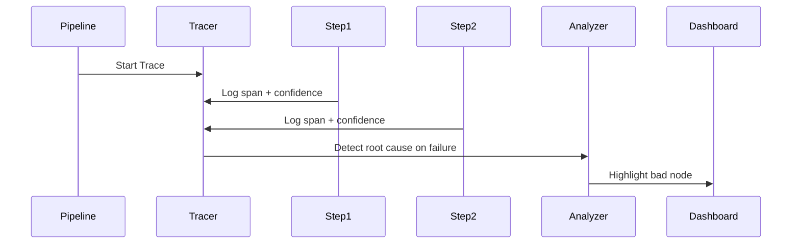

# Architecture: Failure Forensics Tool for AI Pipelines

## System Diagram
The following Mermaid.js sequence diagram maps the core workflow and interactions:

## Component Breakdown
- **Core Technology**: TypeScript, LangChain.js, OpenTelemetry, SQLite
- **Design Paradigm**: Emphasizes high availability, fault tolerance, and security.
