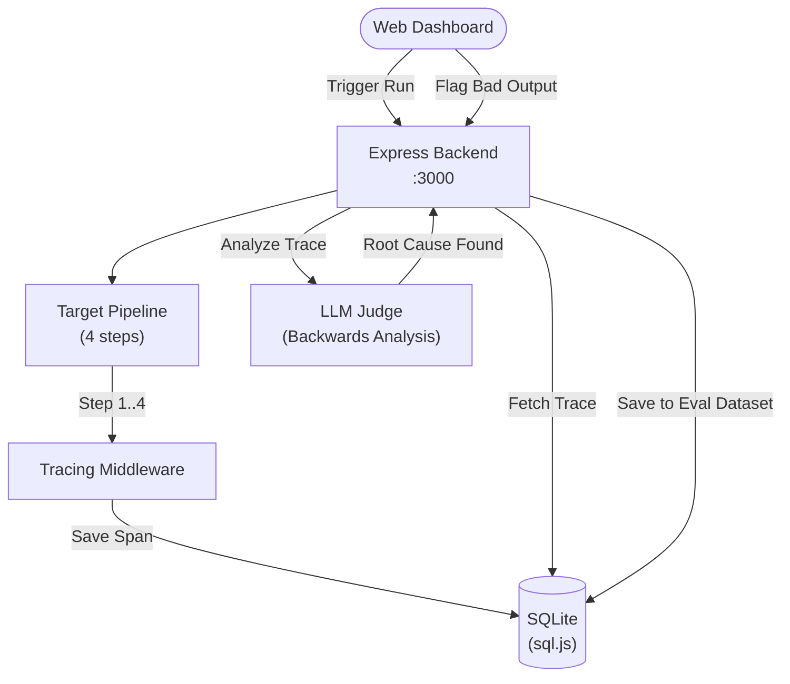
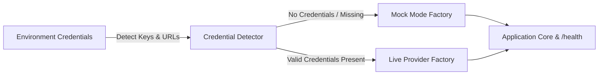

# Architecture — ai-failure-forensics
> Last updated: 2026-08-29 | Maturity: Partial Prototype
> _Observability layer for tracing multi-step AI pipelines and root-causing failures._

## System Diagram

## Component Table
| Component | File | Responsibility | Tech |
|---|---|---|---|
| API Server | `src/server.ts` | REST endpoints for dashboard | Express |
| Tracer | `src/tracer.ts` | Wraps functions to capture input/output | TypeScript |
| Judge | `src/evaluator.ts` | Analyzes traces for root causes | OpenAI / Prompt |
| Database | `src/db.ts` | Stores traces and evaluations | SQLite |

## Dependency Honesty Table
| Dependency | Status | Notes |
|---|---|---|
| SQLite | **Real** | Embedded in-memory DB for prototype. |
| OpenAI API | **Mocked** | Can be toggled to real via `.env`, but test suites use static stubs. |

## Component Breakdown
- **Core Technology**: TypeScript, LangChain.js, OpenTelemetry, SQLite
- **Design Paradigm**: Emphasizes high availability, fault tolerance, and security.

## Progressive Credential Loading & Production Architecture (v0.2.0)

This service implements the **Progressive Credential Loading (PCL)** pattern, decoupling development speed from external infrastructure provisioning:

### Core Architecture Components
1. **Mode Detection Singleton:** Inspects environment configuration at boot time without hard crashes on missing secrets.
2. **Dual-Mode Factory Wrappers:**
   - **Storage / Cache:** In-process maps or SQLite `:memory:` transparently promote to managed Redis or PostgreSQL when connection strings are supplied.
   - **AI Providers:** Deterministic heuristic generators and local embeddings transparently promote to live OpenAI, Anthropic, or Gemini API clients.
3. **Hot-Reload & Dynamic TLS:** File watchers monitor mounted volume paths (Kubernetes ConfigMaps and Secrets) to update certificates and limit configs atomically without process restarts.
4. **Health & Observability:** The `/health` endpoint exposes real-time runtime mode metadata (`mock` vs `live`) across all backing adapters.
